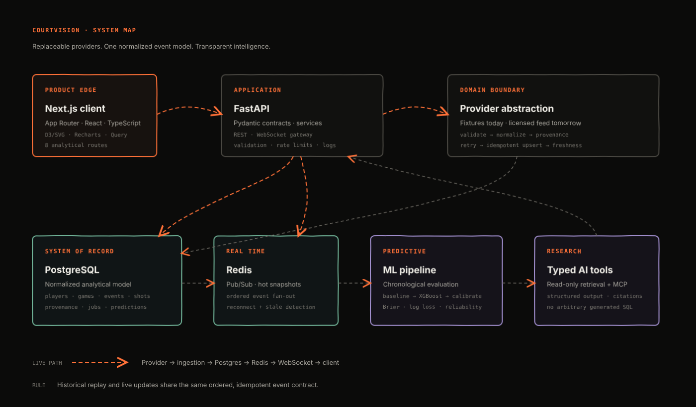
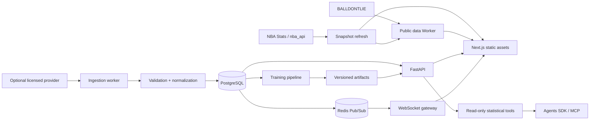

# Architecture

CourtVision is a modular monolith: one web application, one API application, one relational database, and Redis for transient coordination. This keeps operational complexity proportional to a solo-developed product while preserving replaceable boundaries around data providers, analytics, and AI.

## Runtime topology

## Boundaries

### Web application

`apps/web` owns presentation, URL state, client interactions, and visualization. It never receives provider credentials. Real current-season player and shot snapshots are bundled as static assets, with live Worker requests attempted first and snapshot fallback after a strict timeout.

### API application

`apps/api` owns validation, access policy, business calculations, provider selection, persistence, and statistical retrieval. Pydantic response models are the contract boundary. SQLAlchemy models never leak directly to HTTP handlers.

### Provider layer

`BasketballDataProvider` exposes domain-shaped methods instead of vendor responses. Adapters must:

1. preserve permitted raw payloads with provenance;
2. validate the provider response;
3. map external IDs to stable internal IDs;
4. produce normalized domain records;
5. support idempotent upserts and resumable cursors.

The public Worker uses BALLDONTLIE for games and NBA Stats-compatible endpoints for player and shot data. NBA Stats calls are sequential, time-bounded, and cached because simultaneous or cloud-origin calls can stall. The broader FastAPI provider boundary remains available for licensed integrations.

### Persistence

PostgreSQL is the source of truth. Redis is not authoritative: it carries event notifications, caches computed views, and stores bounded live snapshots. A reconnecting client obtains a database-backed snapshot before consuming events after the snapshot sequence.

## Event invariants

- A provider event is uniquely identified by `(source_id, external_event_id)`.
- Events are ordered by `(game_id, sequence)`.
- Duplicates update permitted mutable fields; they do not create a second event.
- Replay and live delivery use the same `GameEvent` shape.
- A client detects gaps and requests a new snapshot rather than guessing.
- Shot attempts reference events when the provider supports that relation.

## Decision record

| Decision | Choice | Reason |
|---|---|---|
| Repository | pnpm monorepo | One lockfile and clear app boundaries |
| Backend shape | Modular monolith | Lowest viable operational cost |
| Primary store | PostgreSQL | Relational integrity and analytical indexes |
| Streaming | Redis Pub/Sub + snapshots | Adequate fan-out without Kafka-scale overhead |
| UI rendering | Next.js App Router | Server rendering plus rich client interactions |
| Visualization | Native SVG/D3 + Recharts | Custom court geometry and standard charts |
| Public data | Real NBA feeds + versioned snapshots | Useful no-cost product with graceful cloud-block fallback |
| ML split | Chronological | Prevents future information leaking backward |
| AI access | Typed read-only tools | Prevents arbitrary generated SQL |

## Failure behavior

- Provider unavailable: ingestion retries with exponential backoff and a bounded attempt count; last-success freshness remains visible.
- Redis unavailable: historical API remains available; live views fall back to polling.
- WebSocket gap: client requests a snapshot and resumes after its sequence.
- Coordinates unavailable: shot surface renders an explicit unavailable state.
- AI unavailable: statistical pages remain fully functional; no fabricated prose is substituted.

## Next architecture milestones

Redis fan-out, sequence-gap recovery, and polling fallback are implemented. The recurring ingestion scheduler, durable computed-view cache, MCP server, and trained model registry remain intentionally incomplete. See [ROADMAP.md](ROADMAP.md).
