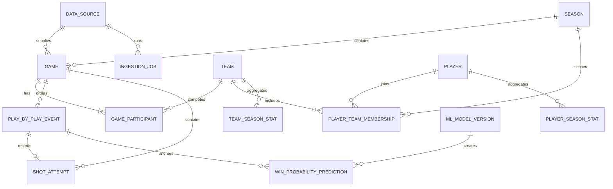

# Database

CourtVision uses PostgreSQL as its authoritative store. The initial migration is `apps/api/migrations/versions/20261112_0001_initial.py`.

## Entity model



## Stable identity

Internal IDs are UUIDs. Vendor IDs live in `external_ids` JSON maps or unique event fields and are never used as primary keys. This allows provider replacement and cross-provider reconciliation without rewriting foreign keys.

## Important constraints

- team abbreviation and player slug are unique;
- one home and one away participant per game;
- box score unique by game, player, and team;
- provider event unique by source and external event ID;
- player/team season aggregates unique within their grain;
- prediction unique by game, event, and model version;
- model name/version pair is unique.

## Query indexes

- player lookup: `players.slug`, `players.last_name`, `players.active`;
- game list: `(season_id, tipoff_at)` and `tipoff_at`;
- replay: `(game_id, sequence)`;
- shot explorer: `(player_id, season_id)` plus game index;
- predictions: `(game_id, created_at)`;
- ingestion monitoring: source and status.

## Ingestion idempotency

Migration `20261112_0002` adds provider version, batch checksum, target external ID, per-outcome row counts, and job metadata. Normalized play-by-play rows retain the source event checksum and ingestion job ID. Replayed batches use `(source_id, external_event_id)` as the conflict boundary: unchanged checksums are skipped, changed records are updated, and reordered input converges to the same batch checksum.

## Migration workflow

```bash
cd apps/api
alembic upgrade head
alembic revision --autogenerate -m "describe change"
alembic downgrade -1
```

Production migrations should run as a release step with a dedicated migration role. Application credentials should not own schema DDL privileges.
