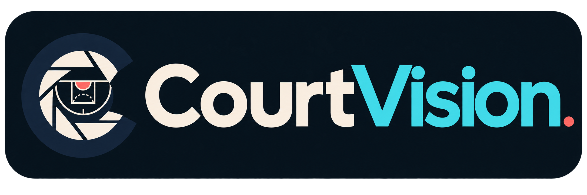

<div align="center">



# COURTVISION

### See the game beyond the box score.

**A production-oriented basketball intelligence platform for possessions, players, shots, and the context connecting them.**

[](apps/web)
[](apps/api)
[](apps/api/pyproject.toml)
[](https://github.com/jonxsong/CourtVision/actions/workflows/ci.yml)
[](#verification)
[](DATA_SOURCES.md)

### [Launch the public CourtVision experience →](https://courtvision-analytics.perkyaisle4.chatgpt.site)

</div>

---

CourtVision is not a generic stats dashboard and it does not manufacture NBA data. It is a full-stack product foundation built around transparent provenance, normalized game events, reproducible analytics, and a premium editorial interface. The repository runs end-to-end without paid credentials using explicitly labeled fictional teams, players, games, and shots.

The public `.chatgpt.site` deployment combines a static product experience with a server-side live-score Worker. The Worker securely retrieves and caches the current NBA slate; the deeper player, shot, replay, and modeling surfaces remain deterministic previews. FastAPI, PostgreSQL, Redis, and provider integrations are available through the repository's full server deployment path.


## What works today

| Surface | Experience | Status |
|---|---|:---:|
| `/` | Editorial intelligence homepage | ✅ |
| `/players` | Searchable player directory | ✅ |
| `/players/[id]` | Player DNA, percentiles, trends, zones | ✅ |
| `/compare` | Interactive side-by-side comparison lab | ✅ |
| `/games` | Game slate and historical results | ✅ |
| `/games/[id]` | Win-probability view and historical replay | ✅ |
| `/shots` | Interactive SVG shot explorer | ✅ |
| `/insights` | Grounded-analysis UX with fact/interpretation separation | ✅ demo retrieval |
| `/operations` | Provider, ingestion, rights, and secret-handling status | ✅ |
| FastAPI | Typed players, games, shots, replay, and baseline endpoints | ✅ |
| PostgreSQL | Normalized schema and initial Alembic migration | ✅ |
| Replay WebSocket | Snapshot, heartbeat, ordered resume | ✅ historical demo |
| BALLDONTLIE adapter | Free players, teams, schedules, game state, and scores | ✅ verified |
| Live score Worker | Hosted secret, CORS boundary, 60-second cache, stale fallback | ✅ public |
| Idempotent ingestion | Checksummed jobs, provenance, stable event upserts | ✅ |
| Redis/live event fan-out | Versioned Pub/Sub, sequence-gap recovery, polling fallback | ✅ |
| ML | Transparent demo baseline + chronological training pipeline | ✅ unvalidated |
| Trained XGBoost + calibration | Needs licensed historical play-by-play corpus | blocked by data |
| OpenAI Agents + MCP | Typed tool boundary designed; production integration | planned |

> [!IMPORTANT]
> The game slate refreshes real NBA scores through a server-side BALLDONTLIE Worker and retains a timestamped snapshot if that service is unavailable. Player analytics, shots, win probability, and possession replay remain **deterministic synthetic fixtures** and are labeled accordingly.

## The product idea

CourtVision treats basketball as a connected event system:

- Player DNA explains production, efficiency, shot shape, and comparable profiles.
- Comparison Lab keeps season, pace, sample size, and normalization visible.
- Game Intelligence connects probability movement to ordered play-by-play events.
- Shot Explorer renders actual coordinates when a provider supplies them and shows an unavailable state otherwise.
- Ask CourtVision is a statistical research interface—not an unrestricted SQL or chat surface.

## Start locally

### One command with Docker

```bash
cp .env.example .env
docker compose up --build
```

- Web: http://localhost:3000
- API: http://localhost:8000
- OpenAPI: http://localhost:8000/docs
- Health: http://localhost:8000/health

### Native development

Requirements: Node 24+, pnpm 11+, Python 3.11+, PostgreSQL 16, Redis 7.

```bash
pnpm install
python -m venv .venv

# Windows
.venv\Scripts\python -m pip install -e "apps/api[dev]"

# macOS/Linux
.venv/bin/python -m pip install -e "apps/api[dev]"

pnpm dev
```

Run the API separately:

```bash
cd apps/api
uvicorn courtvision.main:app --reload --port 8000
```

## Repository map

```text
CourtVision/
├── apps/
│   ├── web/                 # Next.js App Router product UI
│   └── api/                 # FastAPI, providers, models, migrations
├── docs/                    # Rendered/editable architecture assets
├── .github/workflows/       # CI checks
├── docker-compose.yml       # Web + API + PostgreSQL + Redis
├── ARCHITECTURE.md
├── DATA_SOURCES.md
├── DATABASE.md
├── API.md
├── ML_MODEL.md
├── DEVELOPMENT.md
├── DEPLOYMENT.md
└── ROADMAP.md
```

## Verification

Current local checkpoint:

- Next.js production build: pass
- ESLint with zero warnings: pass
- TypeScript strict check: pass
- Vitest: 4 tests pass
- Pytest: 33 tests pass
- Live Worker: 3 tests pass
- Critical backend business-logic coverage: 83% (branch coverage enabled; declarative ORM, command entrypoints, and DB wiring excluded)
- Ruff: pass
- mypy strict: pass
- Lighthouse mobile, optimized static build: 83 performance, 100 accessibility, 100 best practices, 100 SEO, 0 CLS (local server without compression/cache headers)
- Public cached live API, 50 sequential requests: 109.6 ms p50, 428.5 ms p95; the 200 ms p95 release gate is not yet met
- Docker Compose configuration validation: pass
- Docker image build: not run in this checkpoint because the local Docker daemon was unavailable

The same web and API checks pass in GitHub Actions on `main`. Lighthouse, container integration, migration replay against PostgreSQL, and latency targets remain to be measured before a complete production release.

```bash
pnpm lint
pnpm typecheck
pnpm test:web
.venv\Scripts\python -m coverage run --rcfile apps/api/pyproject.toml -m pytest apps/api/tests
.venv\Scripts\python -m coverage report --rcfile apps/api/pyproject.toml
.venv\Scripts\python -m ruff check apps/api/courtvision apps/api/tests
.venv\Scripts\python -m mypy --config-file apps/api/pyproject.toml apps/api/courtvision
pnpm build
pnpm benchmark:live-api -- 50
```

## Design principles

The visual system uses midnight navy, warm ivory, electric cyan, and a restrained coral signal accent. Dense analytical surfaces are separated by editorial whitespace; animation is purposeful and reduced-motion aware. All primary actions are keyboard reachable, SVG charts have accessible labels, and loading/error/empty states are first-class.

## Documentation

- [Architecture](ARCHITECTURE.md) — service boundaries, data flow, and decisions
- [Data sources](DATA_SOURCES.md) — terms, coverage, risks, and provider strategy
- [Database](DATABASE.md) — entities, constraints, provenance, and query paths
- [API](API.md) — HTTP contracts and error behavior
- [ML model](ML_MODEL.md) — leakage rules, evaluation, and current limitations
- [Development](DEVELOPMENT.md) — local workflow and quality gates
- [Deployment](DEPLOYMENT.md) — container topology and production requirements
- [Roadmap](ROADMAP.md) — honest phase status and next milestones

## License and data notice

Source licensing has not yet been selected. NBA names, marks, statistics, and game accounts may carry separate rights and use restrictions. The repository includes no scraped NBA dataset and should not be deployed with NBA data until provider and redistribution rights are confirmed.

<div align="center"><sub>Built to make the evidence as compelling as the story.</sub></div>
